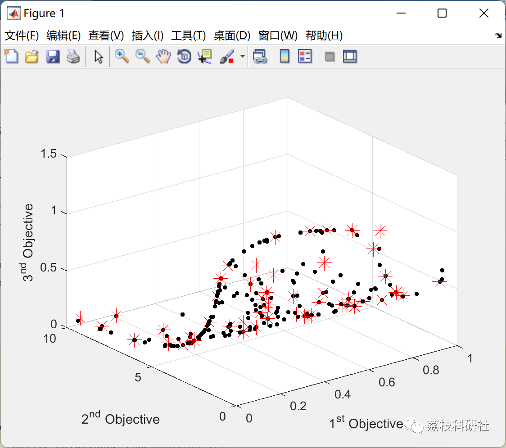
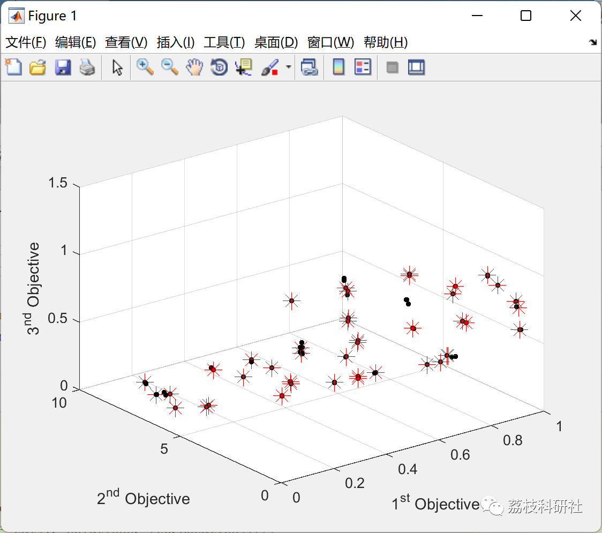

# Multi-Object Harris Hawk Optimization (MOHHO) (Matlab Code Implementation)

💥💥💥💞💞💞💞 Welcome to this blog❤️❤️❤️💥💥💥
🏆 Bloggers' Advantage: 🌞🌞🌞 The content of the blog strives to be rigorous in thought and clear in logic, for the convenience of readers.
⛳️ Mantra: The journey of a hundred miles is half done in the last ninety.
Litchi Research Society
Code Collection: Power System, Intelligent Algorithms and Applications, Neural Network Prediction, Path Planning, Optimized Scheduling, Workshop Scheduling, Image Processing, Signal Processing...
🎁Column Directory Link:
🌈🌈🌈🌟🌟🌟Electrical Code Intelligent Algorithm and Its Application Path Planning Neural Network Predictive Optimization Scheduling Image Processing Workshop Scheduling Signal Processing Romantic Her My Philosophical Thoughts Math Modeling Complete Code Matters
💥1 Overview
In nature, Harris hawks use their sharp eyes to scout the environment and track prey. However, in the vast desert regions of southern Arizona, sometimes life is not easy. In the desert, it often takes several hours to wait, observe, and track prey.
The Harris Hawk Optimizer (HO) was proposed by Heidari, Mirjali, and others in 2019. It must be said that Professor Miraii is truly remarkable! The Harris Hawk primarily resides in the southern region of Arizona, USA. Its uniqueness lies in its ability to engage in a distinctive cooperative foraging activity with other members of its family group, unlike other raptors which typically hunt alone. This makes the Harris Hawk's unique group hunting behavior particularly suitable for being modeled as a collective intelligence optimization process. When discussing an algorithm, one must first examine its strengths: this algorithm possesses strong global search capabilities and requires fewer parameters to tune.
Detailed article explanation:
📚2 Running Results
🎉3 References
[1]milad eshkevari (2022). Multi-objective Harris Hawks Optimization (MOHHO)  
🌈4 Matlab code implementation

## Images

<!-- PAYMENT_BLOCK -->

## Get this dataset

- Payment link (Stripe): [Buy now](https://buy.stripe.com/3cs8yP7sY87d0vu9AB)
- Payment QR code: 

<!-- /PAYMENT_BLOCK -->
